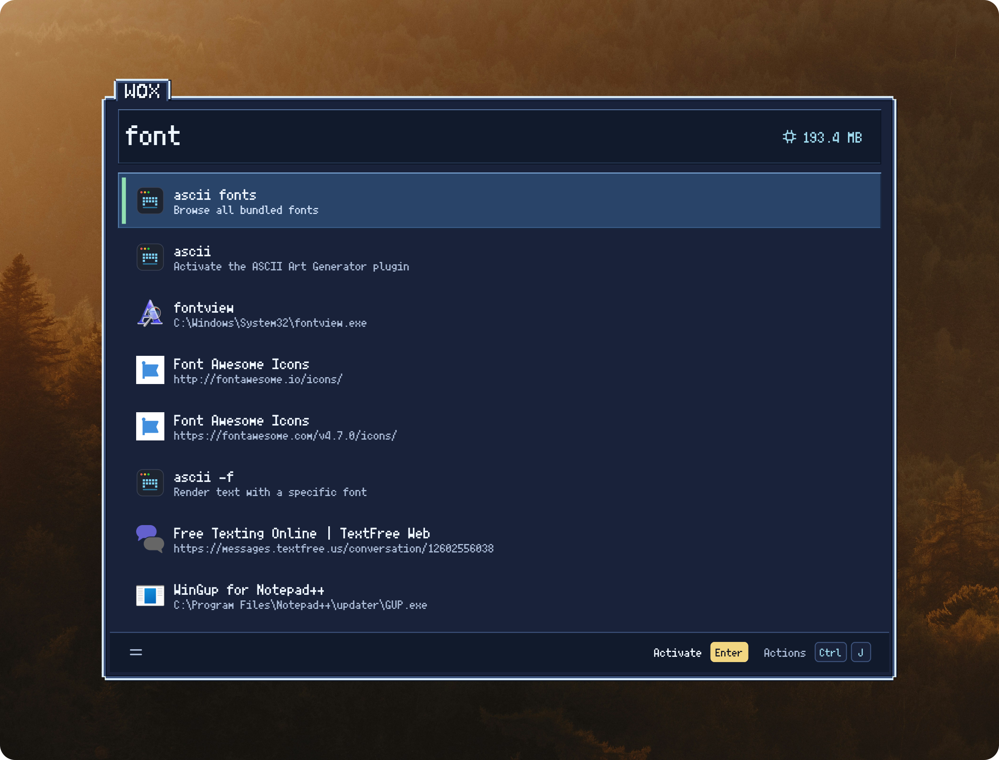

# 8-Bit Night

A navy Wox theme with stepped pixel frames, mint selection markers, and gold Enter keycaps. Inspired by [8bitMyGoUI](https://github.com/ELY-Open-Source/8bitMyGoUI).

For the best pixel-art look, install Fusion Pixel Font and select it under **Settings → UI → Font family** in Wox. [Get Fusion Pixel Font](https://github.com/TakWolf/fusion-pixel-font)

Requires **Wox v2.4.5**

## Install

query in Wox

`theme 8bit`